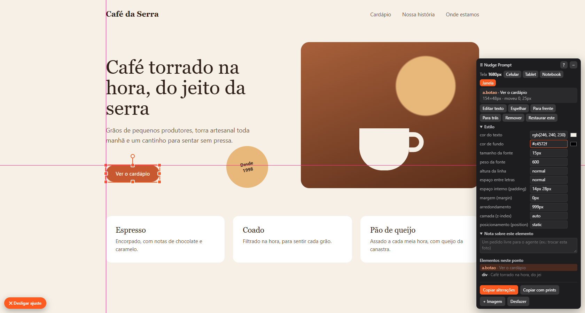
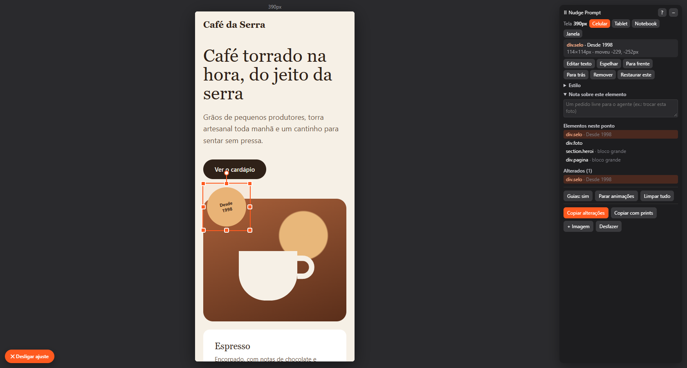

# Nudge Prompt

**Nudge your UI, get a prompt.** Open any web page, drag, resize and restyle its elements visually, and copy a text describing every change for an AI coding agent (Claude Code, Codex, Cursor…) to apply in your code.

> The interface and docs are in Portuguese for now.

---

Abre qualquer página num Chrome à parte com um editor por cima: você move, redimensiona, gira, muda opacidade, texto e estilo dos elementos com o mouse, e o Nudge Prompt gera um texto com todas as alterações para colar no agente de IA aplicar no código.



Depois de ajustar, **Copiar alterações** gera um texto assim, pronto para colar no agente:

<details>
<summary>Ver o texto gerado</summary>

```text
1. div.selo  "Desde 1998"
   seletor: div.selo:nth-of-type(3)
   posição original na página: x 789px, y 370px · tamanho 142×142px
   mover: 150px para a esquerda, 39px para baixo
   CSS final: translate: -150px 39px
   em proporção da largura do contêiner (1200px): deslocamento horizontal -12.5% · vertical 3.3%
   ou, como é position: absolute, some -150px no left e 39px no top (se estiver preso por right/bottom, subtraia deles)

2. a.botao  "Ver o cardápio"
   seletor: a.botao
   posição original na página: x 304px, y 463px · tamanho 154×48px
   mover: 25px para baixo
   cor de fundo: rgb(47, 33, 24) → #c4572f
   CSS final: translate: 0px 25px; background-color: #c4572f

3. h1  "Café torrado na hora, do jeito da serra"
   seletor: h1
   tamanho da fonte: 64px → 56px
   CSS final: font-size: 56px

4. svg
   seletor: svg
   nota: Trocar o desenho da xícara por uma foto do balcão
```

</details>

## O que ele faz

- **Mover, redimensionar e girar** com o mouse, com guias que grudam nas bordas e centros dos vizinhos e medidas de distância.
- **Editar texto e estilo**: cor, fundo, fonte, espaçamentos, arredondamento e camada.
- **Para frente / Para trás**: passa um elemento por cima ou por baixo do outro sem você mexer em z-index.
- **Seleção múltipla** para alinhar e distribuir.
- **Imagem nova**: arraste um arquivo para a página, cole com Ctrl+V ou escolha pelo botão.
- **Notas** para o agente, por elemento ou da página inteira.
- **Larguras de tela**: Celular, Tablet e Notebook abrem a página num quadro com essa largura. Cada largura guarda os próprios ajustes, e o texto sai separado por largura (uma media query para cada).

  

- **Prints de antes e depois**, com o número de cada alteração marcado na imagem.
- **Arquivo e linha do código** de cada elemento, quando o servidor de desenvolvimento informa (Astro, React até a 18; Vue e Svelte só o arquivo).
- **CSS final** pronto em cada item do texto.
- **Sobrevive ao recarregar**: depois que o agente muda o código, ele confere o que já foi aplicado e avisa o que ficou diferente.

## Requisitos

- Windows (a cópia para a área de transferência e a janela de arquivos usam o PowerShell).
- [Node.js](https://nodejs.org) 18 ou mais novo.
- Google Chrome ou Microsoft Edge instalado.

## Como usar

```bash
git clone https://github.com/felipeebling/Nudge-Prompt.git
```

Dê dois cliques em **`Nudge Prompt.cmd`**. Na primeira vez ele instala o necessário sozinho. Depois pergunta o endereço da página (Enter abre `http://localhost:4321`).

Também dá para abrir direto pelo terminal:

```bash
npm start -- localhost:3000/contato
```

Na janela que abrir, clique em **✎ Nudge Prompt** (canto inferior esquerdo) ou aperte **Ctrl+Shift+E**, ajuste o que quiser e clique em **Copiar alterações**. O texto vai para a área de transferência e para o arquivo `alteracoes.txt`. Cole no chat do agente.

A lista completa de atalhos e recursos está no [LEIA-ME.txt](LEIA-ME.txt).

## Desenvolvimento

| Arquivo | O que é |
|---|---|
| `editor.js` | o editor, injetado em todas as páginas |
| `ligacoes.mjs` | funções do Node que o editor chama (copiar, imagem, tela, prints) |
| `abrir.mjs` | abre o navegador |
| `teste/` | página de teste e o teste automático |
| `docs/` | imagens deste README; `node docs/gerar-imagens.mjs` gera de novo, na página `docs/exemplo.html` |

```bash
npm test
```

abre a página de teste num Chrome invisível, usa o editor e confere o texto gerado.

## Licença

[MIT](LICENSE)
